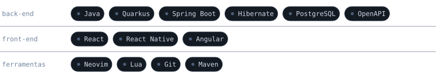
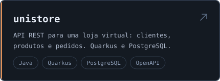
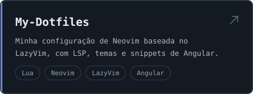

  
  

## ⚡ Sobre mim

Estudo Engenharia de Software na Unifio e tenho foco em back-end com Java, Quarkus e Spring Boot, mas também mexo com React, React Native e Angular. Gosto de resolver problemas e de experimentar linguagem nova.

No momento estou construindo o [unistore](https://github.com/nameless-m/unistore), uma API REST de loja virtual, e afinando a minha configuração de Neovim.

## 🛠️ Stack

  

## 🌩️ Projetos

  
  

